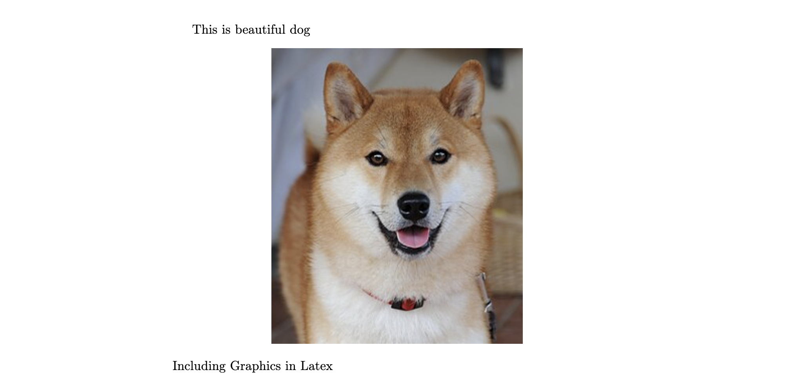
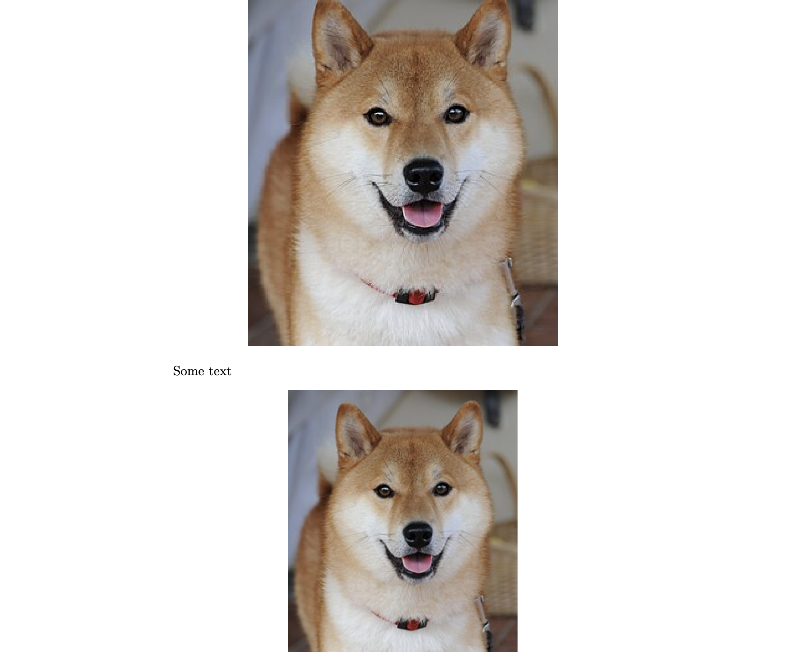
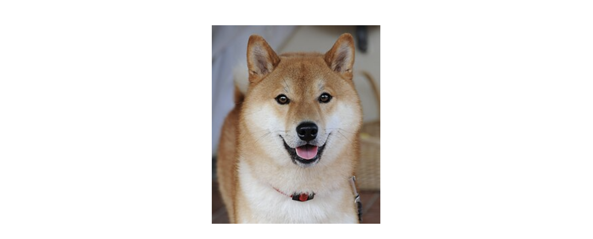
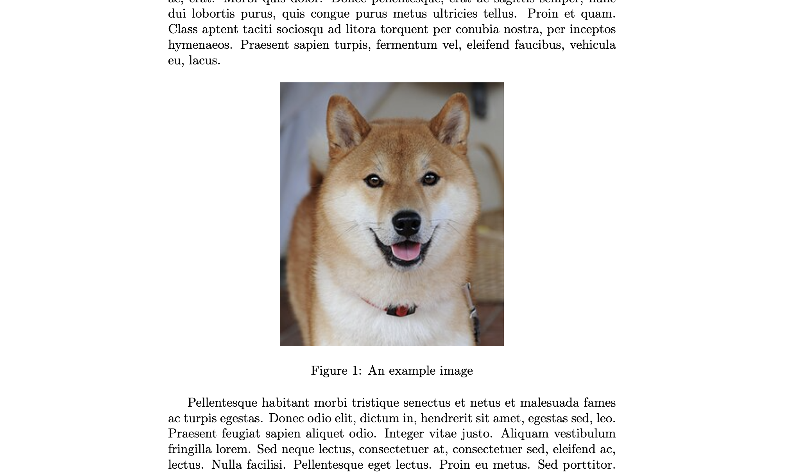
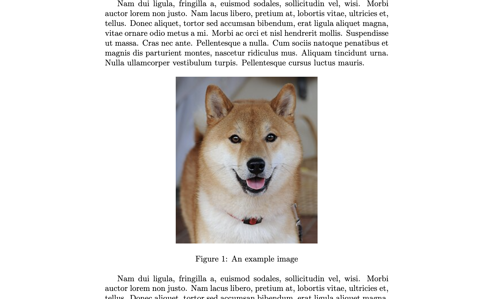
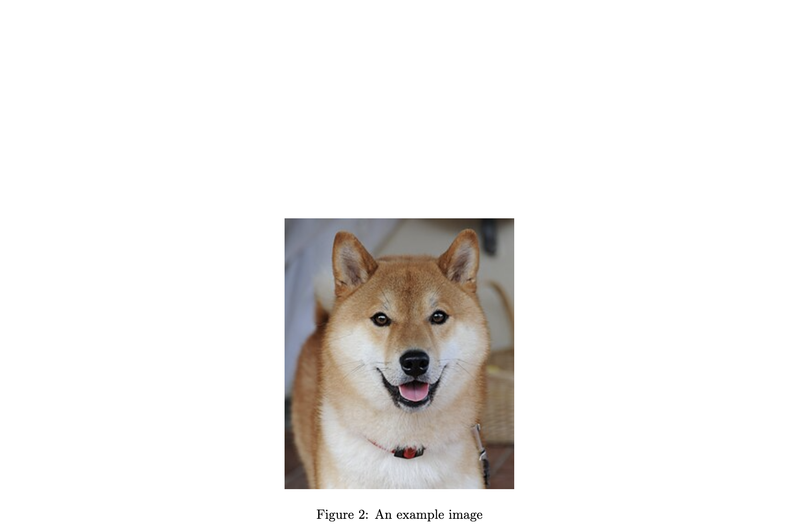
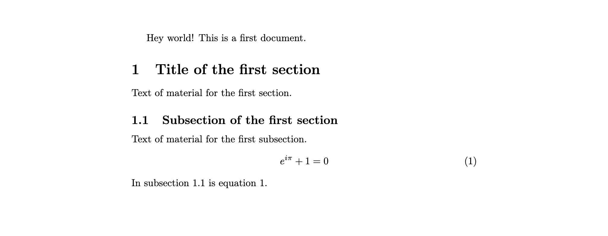

---
## Author
author:
  name: Филибер Никола
  degrees: Магистратура
  orcid: 0000-0000-0000-0000
  email: 1132259430@rudn.ru
  affiliation:
    - name: Российский университет дружбы народов
      country: Российская Федерация
      postal-code: 117198
      city: Москва
      address: ул. Миклухо-Маклая, д. 6
## Title
title: "Лабораторной работе №4"
subtitle: "Computer Skills for Scientific Writing"
license: CC BY
date: today
date-format: "YYYY-MM-DD" # Example: 2025-09-06
---

# Информация

## Докладчик

:::::::::::::: {.columns align=center}
::: {.column width="70%"}

  * Филибер Никола
  * ст., Магистран
  * Магистран кафедры теории вероятностей и кибербезопасности
  * Российский университет дружбы народов им. П. Лумумбы
  * [1132259430@rudn.ru](mailto:1132259430@rudn.ru)


:::
::: {.column width="30%"}


:::
::::::::::::::

# Вводная часть

## Актуальность

- Использование графики повышает наглядность научных и технических документов.
- LaTeX предоставляет средства для удобного добавления, оформления и размещения изображений


## Объект и предмет исследования

- Оформление графических материалов в LaTeX.


## Цели и задачи

- Цель:
    - Изучить основные средства LaTeX для работы с графикой и перекрёстными ссылками.
- Задачи:
    - Изучить способы добавления графики в LaTeX.
    - Изучить работу с плавающими объектами.
    - Освоить создание перекрёстных ссылок.


## Материалы и методы

- Процессор Latex
- cli pdflatex
- git
- github
- Процессор `pandoc` (как часть `quarto`) для входного формата Markdown
- Автоматизация процесса создания: `Makefile`


# Выполнение лабораторной работы

## Подключение пакета graphicx и вставка изображений.
```latex
\documentclass{article}
\usepackage[T1]{fontenc}
\usepackage{graphicx}
\graphicspath{{images/}}
\begin{document}
This is beautiful dog
\begin{center}
    \includegraphics[height=8cm]{dog1.jpg}
\end{center}
Including Graphics in Latex
\end{document}
```

##
{#fig-001 width=70%}


## Изменение размеров, масштаба и обрезка изображений..
```latex
\documentclass{article}
\usepackage[T1]{fontenc}
\usepackage{graphicx}
\begin{document}
  \begin{center}
    \includegraphics[height = 0.5\textheight]{dog1.jpg}
  \end{center}
Some text
\begin{center}
\includegraphics[width = 0.5\textwidth]{image/img1.png}
\end{center}
\end{document}
```
##
{#fig-002 width=70%}

##
{#fig-003 width=70%}


## Размещение изображений с помощью окружения figure
```latex
\documentclass{article}
\usepackage[T1]{fontenc}
\usepackage{graphicx}
\usepackage{lipsum} 
\usepackage{float}
\graphicspath{{images/}}
\begin{document}
\lipsum[1-7]
\begin{figure}[H]
    \centering
    \includegraphics[width=0.5\textwidth]{dog1.jpg}
    \caption{A dog}
\end{figure}
\lipsum[8-15]
\end{document}
```

##
{#fig-004 width=70%}

## Настройка положения плавающих объектов
```latex
\documentclass{article}
\usepackage[T1]{fontenc}
\usepackage{graphicx}
\usepackage{lipsum} 
\usepackage{float}
\graphicspath{{images/}}
\usepackage{lipsum} 
\begin{document}
\lipsum[1-2] 
\begin{figure}[ht]
    \centering
    \includegraphics[width=0.5\textwidth]{dog1.jpg}
    \caption{An example image}
\end{figure}

\begin{figure}[hb]
    \centering
    \includegraphics[width=0.5\textwidth]{dog1.jpg}
    \caption{An example image}
\end{figure}

\lipsum[2-4]
\end{document}
```

##
{#fig-005 width=70%}

##
{#fig-006 width=70%}

## Cохранит изображения в каталоге
```latex
\graphicspath{{figs/}{pics/}}
```

## Создание подписей и перекрёстных ссылок
```latex
\documentclass{article}
\usepackage[T1]{fontenc}
\begin{document}
Hey world!
This is a first document.
\section{Title of the first section}
Text of material for the first section.
\subsection{Subsection of the first section}
\label{subsec:labelone}
Text of material for the first subsection.
\begin{equation}
    e^{i\pi}+1 = 0
    \label{eq:labeltwo}
\end{equation}
In subsection~\ref{subsec:labelone} is
equation~\ref{eq:labeltwo}.
\end{document}
```

##
{#fig-007 width=70%}


# Результаты

В результате работы были освоены основные средства LaTeX для вставки, настройки и размещения изображений, а также создания подписей и перекрёстных ссылок


# Заключение

## Главный вывод

В ходе лабораторной работы были изучены основные способы работы с графикой в LaTeX. Освоены вставка и настройка изображений, работа с плавающими объектами и создание перекрёстных ссылок.

