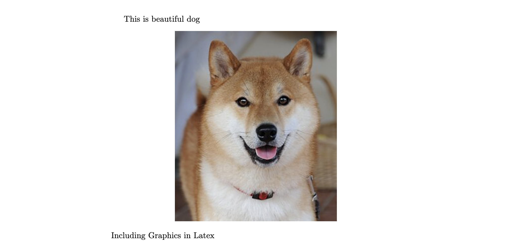
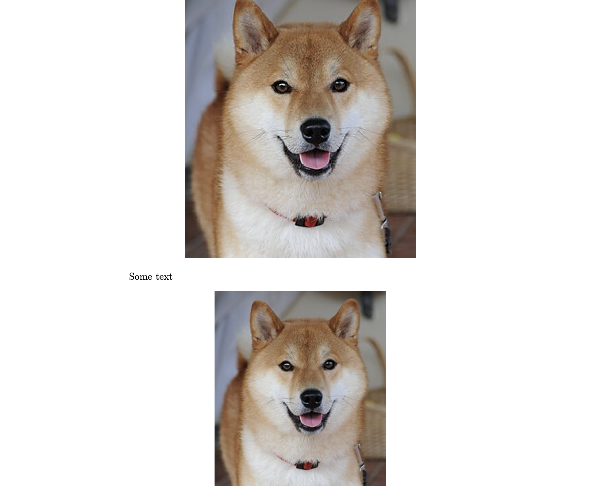
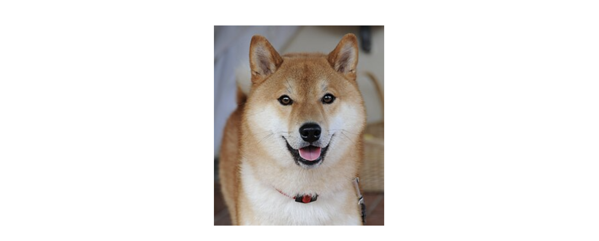
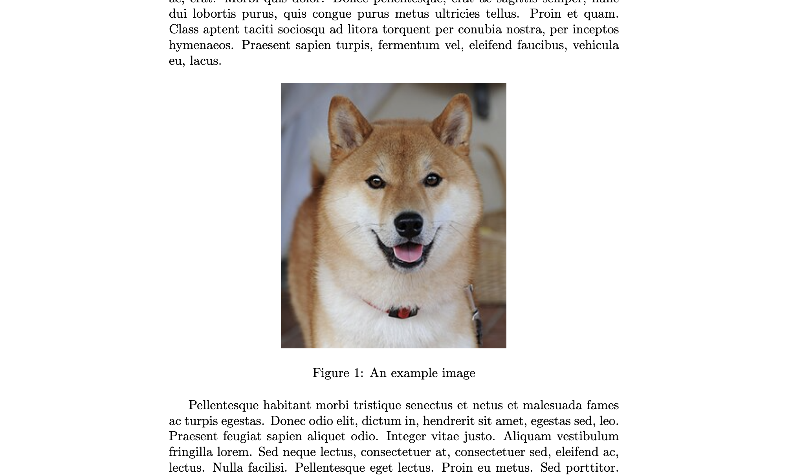
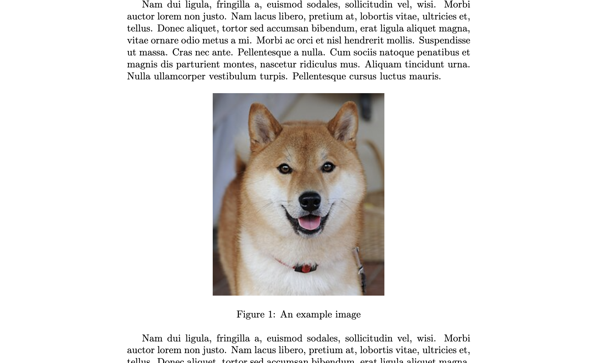
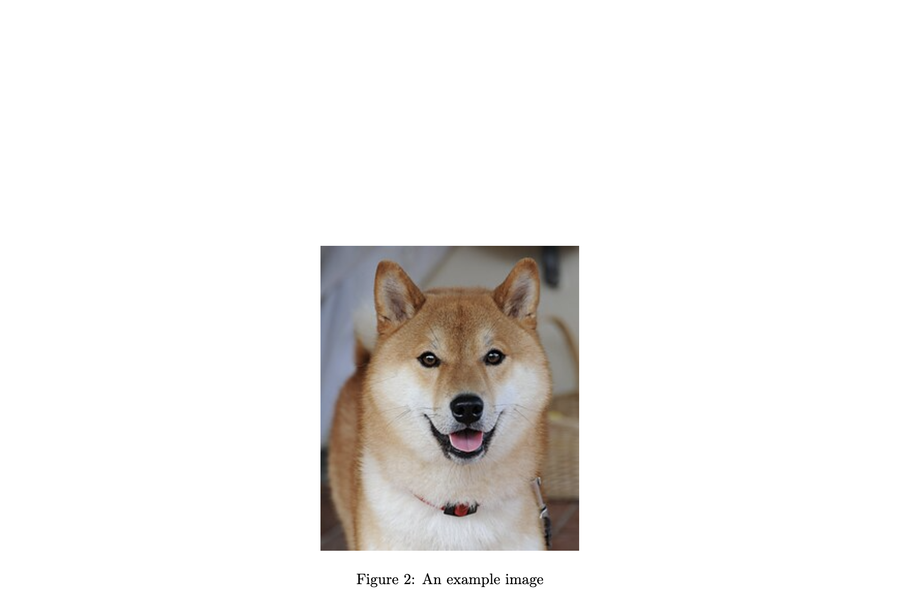
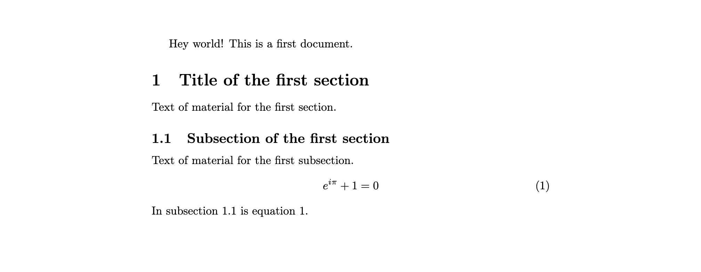

---
## Author
author:
  name: Филибер Никола
  degrees: Магистратура
  orcid: 0000-0000-000-000
  email: 1132259430@rudn.ru
  affiliation:
    - name: Российский университет дружбы народов
      country: Российская Федерация
      postal-code: 117198
      city: Москва
      address: ул. Миклухо-Маклая, д. 6

## Title
title: "Отчёт по лабораторной работе №4"
subtitle: "Computer Skills for Scientific Writing"
license: "CC BY"
abstract: |
  В данной лабораторной работе рассматриваются основные способы работы с графическими изображениями в LaTeX. Изучается подключение и использование пакета graphicx, добавление изображений с помощью команды `\includegraphics`, а также изменение их размера, масштаба, угла поворота и обрезка. Рассматривается размещение изображений в плавающем окружении figure и использование различных параметров позиционирования. Также изучаются организация графических файлов в подкаталогах и создание перекрёстных ссылок с помощью команд `\label` и `\ref`. Дополнительно рассматривается пакет hyperref для создания гиперссылок в документе.


keywords: [лабораторная работа, шаблон, Markdown, Pandoc, LaTeX, graphicx, изображжение; label ]
---

# Введение
Графические материалы являются важной частью научных и технических документов. LaTeX позволяет добавлять изображения, изменять их размеры и управлять их расположением на странице.

## Актуальность

Использование графики повышает наглядность научных и технических документов. LaTeX предоставляет средства для удобного добавления, оформления и размещения изображений, что делает изучение этих возможностей важным для подготовки качественных документов.

## Цель работы

Изучить основные средства LaTeX для работы с графикой и перекрёстными ссылками.

## Задачи

Изучить способы добавления графики в LaTeX.

Освоить изменение размеров и положения изображений.

Изучить работу с плавающими объектами.

Освоить создание перекрёстных ссылок.

## Объект и предмет исследования

оформление графических материалов в LaTeX.


## Методы исследования

В работе используются изучение документации LaTeX[@latex_doc], практическое применение команд для работы с графикой и экспериментальное сравнение различных способов размещения изображений.


## Схема выполнения работы

На рис. -@fig-flowchart представлена общая последовательность действий при выполнении работы.


::: {#fig-flowchart}

```{mermaid}
%%| fig-width: 100%
graph TD
    A@{ shape: circle, label: "Начало" } --> B[Подключение пакета graphicx]
    B --> C[Добавление изображения с помощью \includegraphics]
    C --> D[Изменение размера, масштаба и положения изображения]
    D --> E[Работа с плавающим окружением figure]
    E --> F[Сохранить изображения в катлоге ]
    F --> G[Добавление подписей и перекрёстных ссылок]
    G --> H[Проверка результата компиляции документа]
    H --> I[Поместить в git-репозиторий]
    I --> J[Сделать релиз git]
    J --> K@{ shape: dbl-circ, label: "Конец" }
```

Блок-схема выполнения лабораторной работы

:::

# Теоретическая часть

В табл. -@tbl-latex-graphics приведено краткое описание основных пакетов и команд LaTeX для работы с графикой.

| Пакеты & команды                | Описание                                                  |
|---------------------------------|-----------------------------------------------------------|
| `\usepackage{graphicx}`         | Подключает пакет для работы с графикой                    |
| `\includegraphics`              | Добавляет изображения: EPS, PNG, JPG и PDF                |
| `\end{center}`                  | Размещает изображение по центру страницы                  |
| `\textheight`                   | Определяет высоту текстовой области страницы              |
| `\textwidth`                    | Определяет ширину текстовой области страницы              |
| `clip trim`                     | Обрезают части изображения                                |
| `\graphicspath{{figs/}`         | Задаёт каталоги для поиска изображений            |
| `\usepackage{float}`            | Позволяет создавать новые типы плавающих объектов         |
| `\caption`                      | Добавляет подпись к изображению                           |
| `\usepackage{trivfloat}`        | Позволяет создавать новые типы плавающих объектов         |
| `\label{...}`                   | Создаёт метку для элемента документа                      |
| `\ref{...}`                     | Создаёт ссылку на элемент по его метке                    |
| `\centering`                    | Размещает изображение по центру страницы                  |
| `h`                             | Здесь если возиожно                                       |
| `t`                             | В начале документа                                        |
| `b`                             | Bottom of the page                                        |
| `p`                             | Отдельная страница только для floats                      |
: описание основных пакетов и команд LaTeX для работы с графикой {#-@tbl-latex-graphics}

Более подробно LaTeX в [@latex_doc; @practical_scientific_writing].

# Материалы и методы

Для выполнения работы использовалась система LaTeX[@latex_doc; @git_doc; @github_doc; @robbins_book_bash_en; @zarrelli_book_mastering-bash_en; @make_doc] и пакеты graphicx, float, trivfloat и hyperref. В качестве материалов использовались графические файлы форматов PNG, JPG и PDF.

Работа выполнялась последовательно: подключение необходимых пакетов, вставка изображений, изменение их размеров и положения, настройка плавающих объектов, добавление подписей и перекрёстных ссылок.

Результаты проверялись путём компиляции документа и визуального анализа полученного PDF-файла.


# Выполнение лабораторной работы [@practical_scientific_writing]

## Подключение пакета graphicx и вставка изображений.
```latex
\documentclass{article}
\usepackage[T1]{fontenc}
\usepackage{graphicx}
\graphicspath{{images/}}
\begin{document}
This is beautiful dog
\begin{center}
    \includegraphics[height=8cm]{dog1.jpg}
\end{center}
Including Graphics in Latex
\end{document}
```

{#fig-001 width=70%}

## Изменение размеров, масштаба и обрезка изображений..
```latex
\documentclass{article}
\usepackage[T1]{fontenc}
\usepackage{graphicx}
\begin{document}
  \begin{center}
    \includegraphics[height = 0.5\textheight]{dog1.jpg}
  \end{center}
Some text
\begin{center}
\includegraphics[width = 0.5\textwidth]{image/img1.png}
\end{center}
\end{document}
```

{#fig-002 width=70%}

{#fig-003 width=70%}

## Размещение изображений с помощью окружения figure
```latex
\documentclass{article}
\usepackage[T1]{fontenc}
\usepackage{graphicx}
\usepackage{lipsum} 
\usepackage{float}
\graphicspath{{images/}}
\begin{document}
\lipsum[1-7]
\begin{figure}[H]
    \centering
    \includegraphics[width=0.5\textwidth]{dog1.jpg}
    \caption{A dog}
\end{figure}
\lipsum[8-15]
\end{document}
```

{#fig-004 width=70%}

## Настройка положения плавающих объектов
```latex
\documentclass{article}
\usepackage[T1]{fontenc}
\usepackage{graphicx}
\usepackage{lipsum} 
\usepackage{float}
\graphicspath{{images/}}
\usepackage{lipsum} 
\begin{document}
\lipsum[1-2] 
\begin{figure}[ht]
    \centering
    \includegraphics[width=0.5\textwidth]{dog1.jpg}
    \caption{An example image}
\end{figure}

\begin{figure}[hb]
    \centering
    \includegraphics[width=0.5\textwidth]{dog1.jpg}
    \caption{An example image}
\end{figure}

\lipsum[2-4]
\end{document}
```

{#fig-005 width=70%}

{#fig-006 width=70%}

## Cохранит изображения в каталоге
```latex
\graphicspath{{figs/}{pics/}}
```

## Создание подписей и перекрёстных ссылок
```latex
\documentclass{article}
\usepackage[T1]{fontenc}
\begin{document}
Hey world!
This is a first document.
\section{Title of the first section}
Text of material for the first section.
\subsection{Subsection of the first section}
\label{subsec:labelone}
Text of material for the first subsection.
\begin{equation}
    e^{i\pi}+1 = 0
    \label{eq:labeltwo}
\end{equation}
In subsection~\ref{subsec:labelone} is
equation~\ref{eq:labeltwo}.
\end{document}
```

{#fig-007 width=70%}

# Результаты

В результате работы были освоены основные средства LaTeX для вставки, настройки и размещения изображений, а также создания подписей и перекрёстных ссылок.

# Обсуждение результатов

Полученные результаты показали, что LaTeX предоставляет удобные средства для управления графикой. Использование плавающих объектов позволяет гибко размещать изображения, а перекрёстные ссылки упрощают навигацию по документу.

# Заключение

В ходе лабораторной работы были изучены основные способы работы с графикой в LaTeX. Освоены вставка и настройка изображений, работа с плавающими объектами и создание перекрёстных ссылок.

# Список литературы {.unnumbered}


::: {#refs}
:::


