---
## Author
author:
  name: Филибер Никола
  degrees: Магистратура
  orcid: 0000-0000-0000-0000
  email: 1132259430@rudn.ru
  affiliation:
    - name: Российский университет дружбы народов
      country: Российская Федерация
      postal-code: 117198
      city: Москва
      address: ул. Миклухо-Маклая, д. 6
## Title
title: Таблицы в LaTex
subtitle: "Computer Skills for Scientific Writing"
license: CC BY
date: today
date-format: "YYYY-MM-DD" # Example: 2025-09-06
---

# Информация

## Докладчик

:::::::::::::: {.columns align=center}
::: {.column width="70%"}

  * Филибер Никола
  * ст., Магистран
  * Магистран кафедры теории вероятностей и кибербезопасности
  * Российский университет дружбы народов им. П. Лумумбы
  * [1132259430@rudn.ru](mailto:1132259430@rudn.ru)
  

:::
::: {.column width="30%"}


:::
::::::::::::::


# Вводная часть

## Актуальность

- Таблицы широко используются в научных и технических документах для структурированного представления данных. 
- LaTeX позволяет создавать таблицы различной сложности, обеспечивая точное выравнивание, гибкую настройку и профессиональное оформление. 
- Освоение этих инструментов важно для подготовки качественных научных работ, отчётов и публикаций.


## Цели и задачи

- Цель:
    - Изучить основные способы создания и форматирования таблиц в LaTeX.
- Задачи:
    - Изучить основные принципы создания таблиц в LaTeX.

    - Изученить способов добавления вертикальных и горизонтальных линий в таблицы LaTeX.

    - Научиться создавать многостраничные таблицы с помощью longtable.


## Материалы и методы

- Процессор Latex
- cli pdflatex
- git
- github
- Процессор pandoc (как часть quarto) для входного формата Markdown
- Автоматизация процесса создания: Makefile

# Выполнение лабораторной работы

## Таблица с выравниванием по левому краю

```latex
\documentclass{article}
\usepackage[T1]{fontenc}
\usepackage{array}
\begin{document}
\begin{tabular}{lll}
  Animal & Food & Size \\
  dog & meat & medium \\
  horse & hay & large \\
  frog & flies & small \\
\end{tabular}
\end{document}
``` 
##

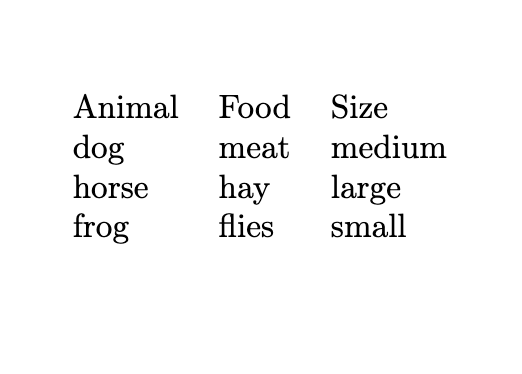{#fig-001 width=70%}

## Таблица с выравниванием по провому краю
```latex
\documentclass{article}
\usepackage[T1]{fontenc}
\usepackage{array}
\begin{document}
\begin{tabular}{rrr}
  Animal & Food & Size \\
  dog & meat & medium \\
  horse & hay & large \\
  frog & flies & small \\
\end{tabular}
\end{document}
``` 
##

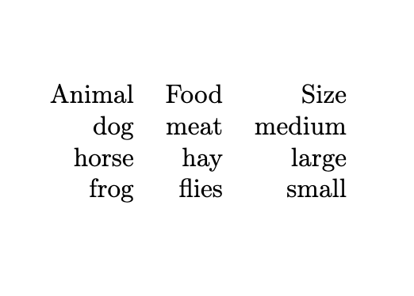{#fig-002 width=70%}


## Таблица с выравниванием по центру
```latex
\documentclass{article}
\usepackage[T1]{fontenc}
\usepackage{array}
\begin{document}
\begin{tabular}{ccc}
  Animal & Food & Size \\
  dog & meat & medium \\
  horse & hay & large \\
  frog & flies & small \\
\end{tabular}
\end{document}
``` 
##
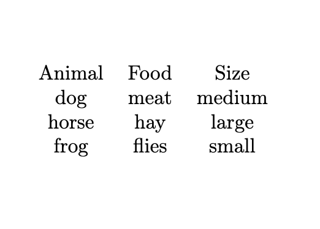{#fig-003 width=70%}


## Таблицы с большим объёмом текста
```latex
\documentclass{article}
\usepackage[T1]{fontenc}
\usepackage{array}
\begin{document}
\begin{tabular}{cp{9cm}}
  Animal  & Description \\
  dog     & The dog is a member of the genus Canis, which forms part of the wolf-like canids and is the most widely abundant terrestrial carnivore. \\
  cat     & The cat is a domestic species of small carnivorous mammal. It is the only domesticated species in the family Felidae and is often referred to as the domestic cat to distinguish it from the wild members of the family. \\
\end{tabular}
\end{document}
```
##
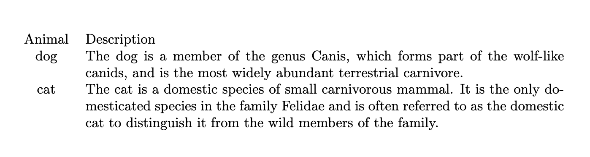{#fig-004 width=70%}


## Cоздание таблицу с использованием конструкцию `*{num}{string}`

```latex
\documentclass{article}
\usepackage[T1]{fontenc}
\usepackage{array}
\begin{document}
\begin{tabular}{*{3}{l}}
  Animal & Food & Size \\
  dog & meat & medium \\
  horse & hay & large \\
  frog & flies & small \\
\end{tabular}
\end{document}
```
##
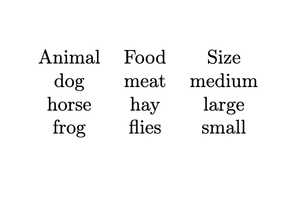{#fig-005 width=70%}

## Добавление линий в таблицы с помощью пакета booktabs

Пакет booktabs предоставляет четыре команды для создания горизонтальных линий в таблицах. Основные из них: 
- `\toprule` — верхняя линия, 
- `\midrule` — промежуточная 
- `\bottomrule` — нижняя. 
Каждая команда должна располагаться в начале строки или после другой линии.

##
```latex
\documentclass{article}
\usepackage[T1]{fontenc}
\usepackage{array}
\usepackage{booktabs}
\begin{document}
\begin{tabular}{lll}
  \toprule
  Animal & Food & Size \\
  \midrule
  dog & meat & medium \\
  horse & hay & large \\
  frog & flies & small \\
  \bottomrule
\end{tabular}
\end{document}
```

##
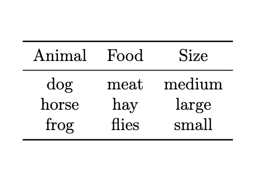{#fig-006 width=70%}

##
Команда `\cmidrule`. формат {начало-конец}, например, `\cmidrule{1-3}`.

##
```latex
\documentclass{article}
\usepackage[T1]{fontenc}
\usepackage{array}
\usepackage{booktabs}
\begin{document}
\begin{tabular}{lll}
  \toprule
  Animal & Food & Size \\
  \midrule
  dog & meat & medium \\
  \cmidrule{1-2}
  horse & hay & large \\
  \cmidrule{1-1}
  \cmidrule{3-3}
  frog & flies & small \\
  \bottomrule
\end{tabular}
\end{document}
```
##
{#fig-007 width=70%}

## Добавление отступа

Команда `\addlinespace` позволяет добавить небольшой вертикальный отступ между строками таблицы.

##
```latex
\documentclass{article}
\usepackage[T1]{fontenc}
\usepackage{array}
\usepackage{booktabs}
\begin{document}
\begin{tabular}{cp{9cm}}
  \toprule
  Animal & Description \\
  \midrule
  dog & The dog is a member of the genus Canis, which forms
  part of the wolf-like canids, and is the most widely abundant terrestrial  carnivore. \\
  \addlinespace
  cat & The cat is a domestic species of small carnivorous
  mammal. It is the only domesticated species in the family Felidae and is often referred
  to as the domestic cat to distinguish it from the wild members of the↪ family. \\
\bottomrule
\end{tabular}
\end{document}
```

##
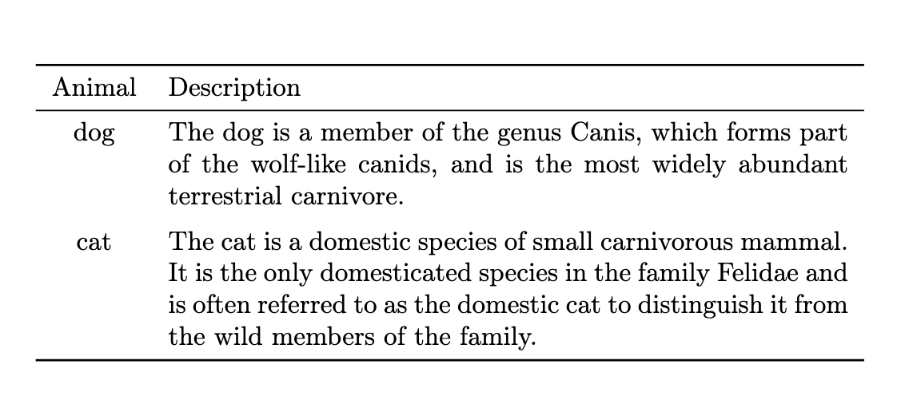{#fig-008 width=70%}


## Объединение ячеек таблицы

В LaTeX для горизонтального объединения ячеек используется команда `\multicolumn`, которая принимает три аргумента:

1. Количество объединяемых столбцов.
2. Выравнивание содержимого.
3. Содержимое объединённой ячейки.

Например, `\multicolumn{2}{c}{Text}` объединяет два столбца с выравниванием по центру.

##
```latex
\documentclass{article}
\usepackage[T1]{fontenc}
\usepackage{array}
\usepackage{booktabs}
\begin{document}
\begin{tabular}{lll}
  \toprule
  Animal & Food & Size \\
  \midrule
  dog & meat & medium \\
  horse & hay & large \\
  frog & flies & small \\
  fuath & \multicolumn{2}{c}{unknown} \\
  \bottomrule
\end{tabular}
\end{document}
```
##
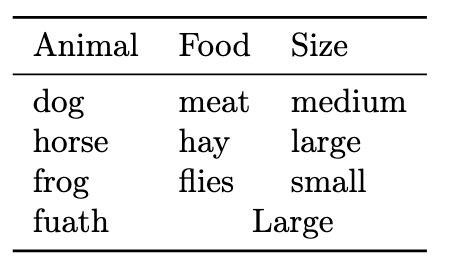{#fig-009 width=70%}


##
Команду `\multicolumn` можно использовать для одной ячейки, чтобы изменить заданное выравнивание столбца. Например, `\multicolumn{1}{c}{Text}` позволяет выровнять заголовок таблицы по центру.

##
```latex
\documentclass{article}
\usepackage[T1]{fontenc}
\usepackage{array}
\usepackage{booktabs}
\begin{document}
\begin{tabular}{lll}
  \toprule
  \multicolumn{1}{c}{Animal} & \multicolumn{1}{c}{Food} &
  \multicolumn{1}{c}{Size} \\↪
  \midrule
  dog & meat & medium \\
  horse & hay & large \\
  frog & flies & small \\
  fuath & \multicolumn{2}{c}{unknown} \\
  \bottomrule
\end{tabular}
\end{document}
```

##
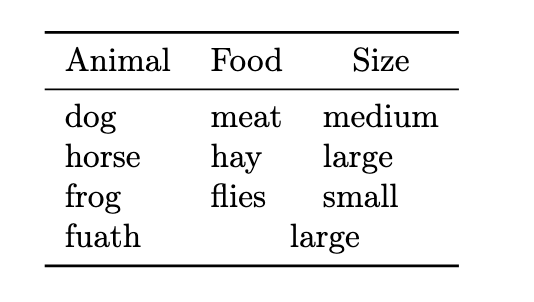{#fig-010 width=70%}

##
LaTeX не поддерживает вертикальное объединение ячеек стандартными средствами. Вместо этого можно оставлять ячейки пустыми, создавая визуальный эффект объединения строк.

##
```latex
\documentclass{article}
\usepackage[T1]{fontenc}
\usepackage{array}
\usepackage{booktabs}
\begin{document}
\begin{tabular}{lll}
  \toprule
  Group & Animal & Size \\
  \midrule
  herbivore & horse & large \\
  \addlinespace
            & deer & medium \\
            & rabbit & small \\
  carnivore & dog & medium \\
            & cat & small \\
            & lion & large \\
  \addlinespace
    omnivore  & crow & small \\
              & bear & large \\
              & pig & medium \\
  \bottomrule
\end{tabular}
\end{document}
```

##
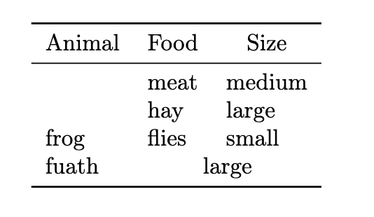{#fig-011 width=70%}

## Дополнительные параметры настройки столбцов таблицы.

Символы `>` и `<` позволяют добавлять команды форматирования до и после содержимого ячеек столбца. Например, с их помощью можно выделить текст первого столбца курсивом и добавить двоеточие после каждого значения.

##
```latex
\documentclass{article}
\usepackage[T1]{fontenc}
\usepackage{array}
\usepackage{booktabs}
\begin{document}
\begin{tabular}{>{\itshape}l<{:} *{2}{l}}
  \toprule
  Animal & Food & Size \\
  \midrule
  dog & meat & medium \\
  horse & hay & large \\
  frog & flies & small \\
  \bottomrule
\end{tabular}
\end{document}
```

##
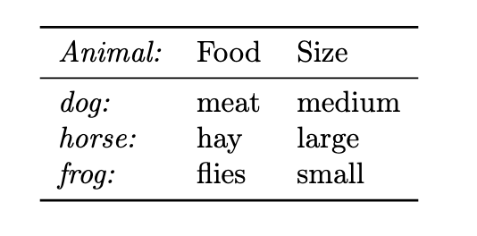{#fig-012 width=70%}


##
Чтобы форматирование столбца не применялось к заголовку, можно использовать команду `\multicolumn`. Она позволяет изменить оформление и выравнивание отдельной ячейки.

##
```latex
\documentclass{article}
\usepackage[T1]{fontenc}
\usepackage{array}
\usepackage{booktabs}
\begin{document}
\begin{tabular}{>{\itshape}l<{:} *{2}{l}}
  \toprule
  \multicolumn{1}{l}{Animal} & Food & Size \\
  \midrule
  dog & meat & medium \\
  horse & hay & large \\
  frog & flies & small \\
  \bottomrule
\end{tabular}
\end{document}
```

##
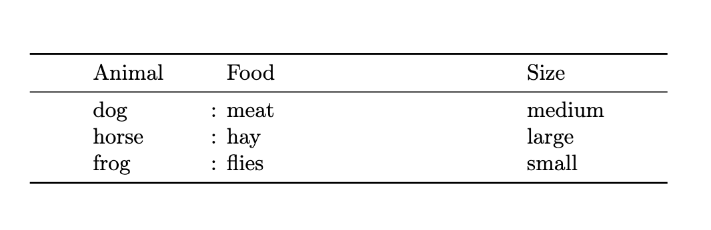{#fig-014 width=70%}

## Настройка расстояния между столбцами таблицы
В LaTeX расстояние между столбцами задаётся параметром `\tabcolsep`. Между соседними столбцами оно составляет `2\tabcolsep`. Изменить значение можно с помощью команды `\setlength{\tabcolsep}`{1cm}

##
```latex
\documentclass{article}
\usepackage[T1]{fontenc}
\usepackage{array}
\setlength\tabcolsep{1cm}
\begin{document}
\begin{tabular}{lll}
  Animal & Food & Size \\
  dog & meat & medium \\
  horse & hay & large \\
  frog & flies & small \\
\end{tabular}
\end{document}
```
##

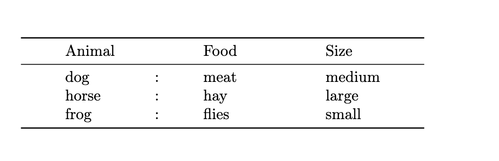{#fig-015 width=70%}

## Вертикальные линии в таблицах
Символ | добавляет вертикальную линию между столбцами, сохраняя отступы. Однако вертикальные линии несовместимы с горизонтальными линиями пакета booktabs.

##
```latex
\documentclass{article}
\usepackage[T1]{fontenc}
\usepackage{array}
\begin{document}
\begin{tabular}{l|ll}
  Animal & Food & Size \\[2pt]
  dog & meat & medium \\
  horse & hay & large \\
  frog & flies & small \\
\end{tabular}
\end{document}
```
##

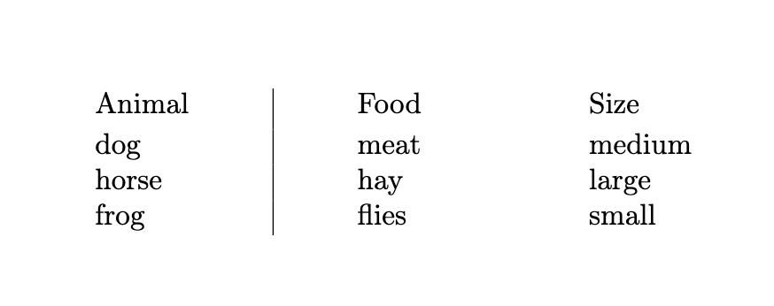{#fig-016 width=70%}


## Настройка горизонтальных линий с помощью пакета booktabs
Команды пакета booktabs позволяют настраивать толщину линий с помощью необязательного аргумента в квадратных скобках. Команда `\cmidrule` также позволяет регулировать отступы по краям линии с помощью параметров r и l

##
```latex
\documentclass{article}
\usepackage[T1]{fontenc}
\usepackage{array}
\usepackage{booktabs}
\begin{document}
\begin{tabular}{@{} lll@{}} \toprule[2pt]
  Animal & Food & Size \\ \midrule[1pt]
  dog & meat & medium \\
  \cmidrule[0.5pt](r{1pt}l{1cm}){1-2}
  horse & hay & large \\
  frog & flies & small \\ \bottomrule[2pt]
\end{tabular}
\end{document}
```
##
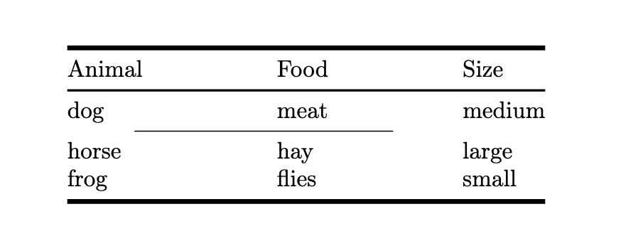{#fig-017 width=70%}

## Выравнивание числовых данных в столбцах таблицы
Для выравнивания числовых данных в таблицах используется тип столбца S из пакета siunitx. Он позволяет автоматически выравнивать числа по десятичному разделителю.

##
```latex
\documentclass{article}
\usepackage[T1]{fontenc}
\usepackage{booktabs}
\usepackage{siunitx}
\begin{document}
\begin{tabular}{SS}
  \toprule
  {Values} & {More Values} \\
  \midrule
  1 & 2.3456 \\
  1.2 & 34.2345 \\
  -2.3 & 90.473 \\
  40 & 5642.5 \\
  5.3 & 1.2e3 \\
  0.2 & 1e4 \\
  \bottomrule
\end{tabular}
\end{document}
```

##
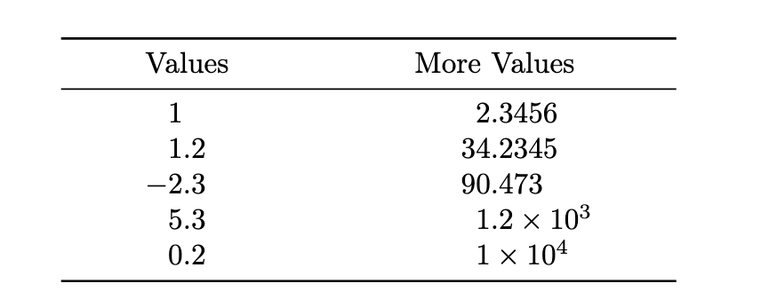{#fig-018 width=70%}


## Настройка общей ширины таблицы
Ширина таблицы в окружении tabular определяется автоматически по её содержимому. Для задания фиксированной ширины используются `tabular*` и `tabularx`. Рекомендуется настраивать ширину таблицы напрямую, при необходимости уменьшая шрифт с помощью `\small`, вместо масштабирования командой `\resizebox`

## tabular*
Окружение tabular* позволяет задать общую ширину таблицы. Команда `\extracolsep{\fill} `автоматически распределяет свободное пространство между столбцами для достижения заданной ширины.

##
```latex
\documentclass{article}
\usepackage[T1]{fontenc}
\usepackage{array}
\begin{document}
\begin{center}
\begin{tabular}{cc}
  \hline
  A & B\\
  C & D\\
  \hline
  \end{tabular}
  \end{center}
  \begin{center}
  \begin{tabular*}{.5\textwidth}{@{\extracolsep{\fill}}cc@{}}
  \hline
  A & B\\
  C & D\\
  \hline
\end{tabular*}
```

##
{#fig-019 width=70%}


## tabularx
Окружение tabularx позволяет автоматически настраивать ширину столбцов типа X в пределах заданной ширины таблицы. В отличие от tabular*, оно изменяет ширину самих столбцов, а не расстояние между ними.


##
```latex
\documentclass{article}
\usepackage[T1]{fontenc}
\usepackage{tabularx}
\begin{document}
\begin{center}
\begin{tabular}{lp{2cm}}
  \hline
  A & B B B B B B B B B B B B B B B B B B B B B B B B\\
  C & D D D D D D D\\
  \hline
  \end{tabular}
  \end{center}
  \begin{center}
  \begin{tabularx}{.5\textwidth}{lX}
  \hline
  A & B B B B B B B B B B B B B B B B B B B B B B B B\\
  C & D D D D D D D\\
\hline
\end{tabularx}
\end{center}
\begin{center}
\begin{tabularx}{\textwidth}{lX}
  \hline
  A & B B B B B B B B B B B B B B B B B B B B B B B B\\
  C & D D D D D D D\\
  \hline
\end{tabularx}
\end{center}
\end{document}
```

##
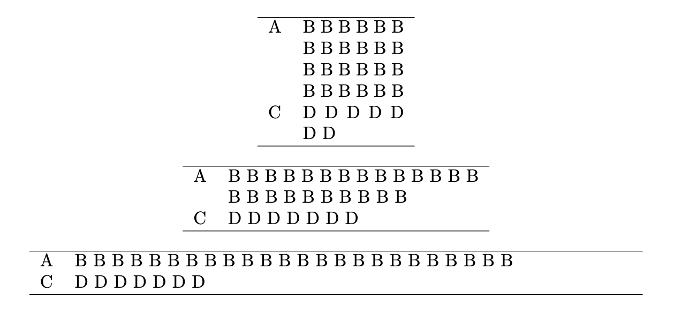{#fig-020 width=70%}

## Многостраничные таблицы

Для создания многостраничных таблиц используется пакет longtable, который позволяет автоматически разбивать таблицу на несколько страниц.

##

```latex
\documentclass{article}
\usepackage[paperheight=8cm,paperwidth=8cm]{geometry}
\usepackage{array}
\usepackage{longtable}
\begin{document}
\begin{longtable*}{cc}
\multicolumn{2}{c}{A Long Table}\\
Left Side & Right Side\\
\hline
\endhead
\hline
\endfoot
aa & bb\\
Entry & b\\
a & b\\
a & b\\
a & b\\
a & b\\
a & bbb\\
a & b\\
a & b\\
a & b\\
a & b\\
a & b\\
a & b\\
a & b b b b b b\\
a & b b b b b\\
a & b b\\
A Wider Entry & b\\
\end{longtable*}
\end{document}
```

##
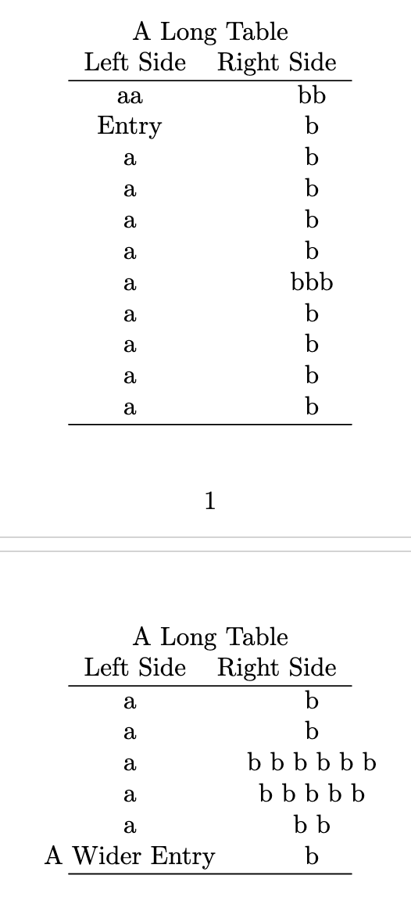{#fig-021 width=70%}


## Примечания к таблицам
Пакет threeparttable позволяет добавлять примечания под таблицей с помощью специальных сносок. Ширина блока примечаний автоматически соответствует ширине таблицы.

##
```latex
\documentclass{article}
\usepackage[T1]{fontenc}
\usepackage{array}
\usepackage{threeparttable}
\begin{document}
\begin{table}
\begin{threeparttable}
\caption{An Example}
\begin{tabular}{ll}
  An entry & 42\tnote{1}\\
  Another entry & 24\tnote{2}\\
\end{tabular}
\begin{tablenotes}
  \item [1] the first note.
  \item [2] the second note.
\end{tablenotes}
\end{threeparttable}
\end{table}
\end{document}
```
##
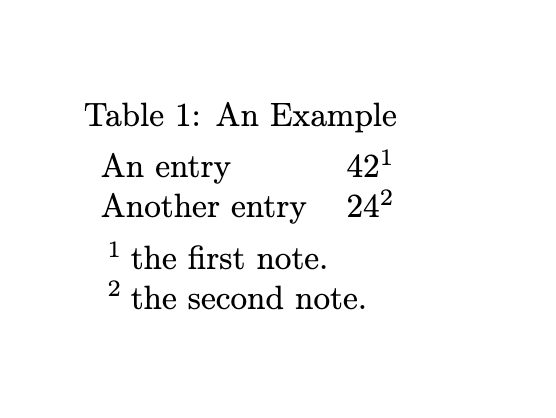{#fig-022 width=70%}


# Результаты

В ходе лабораторной работы изучены основные способы создания и форматирования таблиц в LaTeX.


# Заключение
В ходе лабораторной работы изучены основные инструменты создания и форматирования таблиц в LaTeX. Освоены способы настройки столбцов, объединения ячеек, оформления линий и создания многостраничных таблиц. Полученные знания могут быть использованы при подготовке научных работ и технической документации.