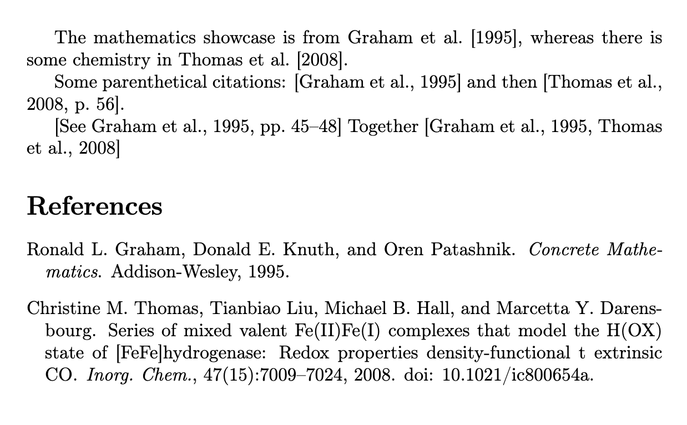
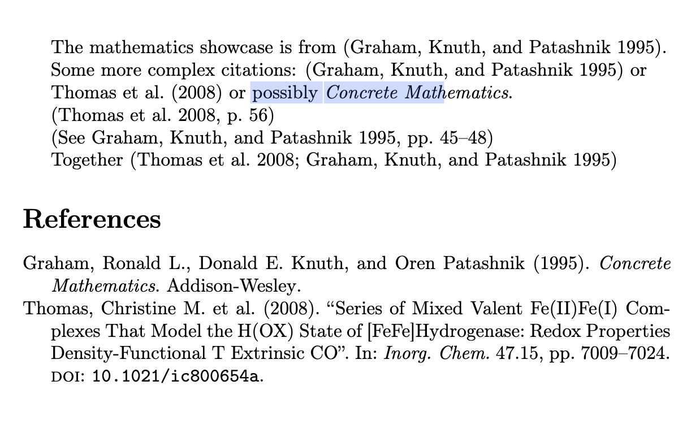
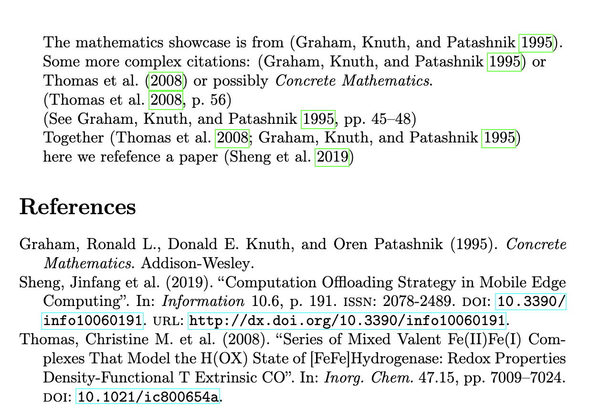
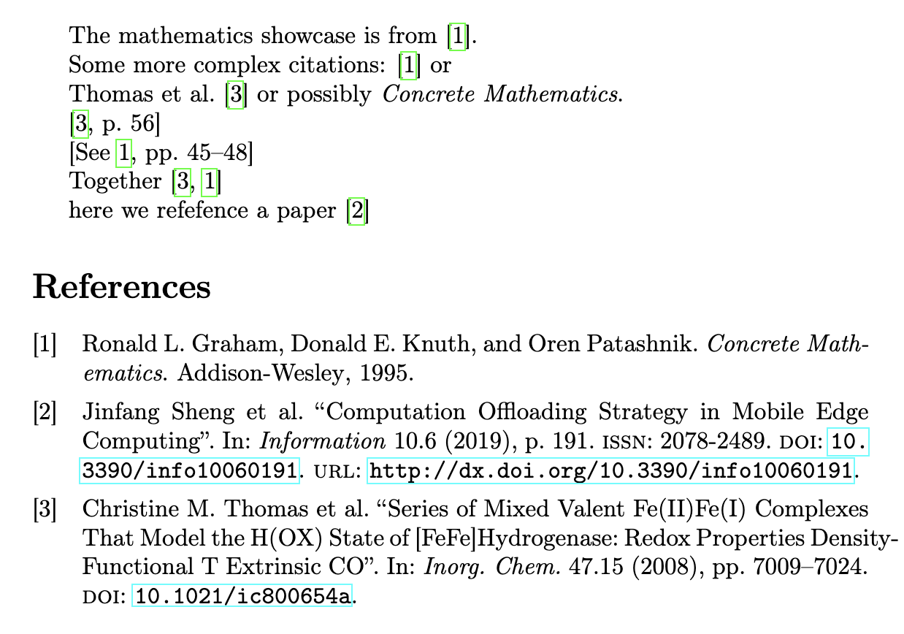
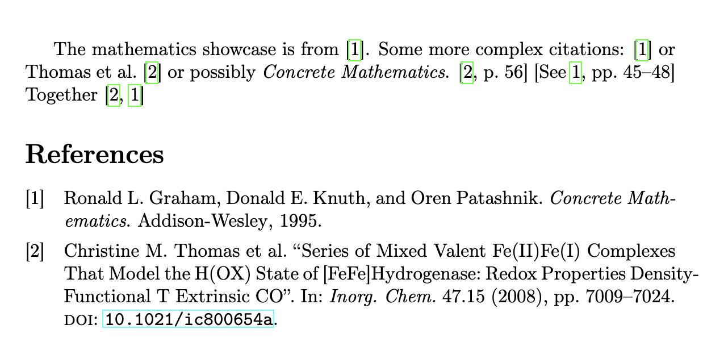

---
## Author
author:
  name: Филибер Никола
  degrees: Магистратура
  orcid: 0000-0000-0000-0000
  email: 1132259430@rudn.ru
  affiliation:
    - name: Российский университет дружбы народов
      country: Российская Федерация
      postal-code: 117198
      city: Москва
      address: ул. Миклухо-Маклая, д. 6
## Title
title: Билиография в LaTex
subtitle: "Computer Skills for Scientific Writing"
license: CC BY
date: today
date-format: "YYYY-MM-DD" # Example: 2025-09-06
---

# Информация

## Докладчик

:::::::::::::: {.columns align=center}
::: {.column width="70%"}

  * Филибер Никола
  * ст., Магистран
  * Магистран кафедры теории вероятностей и кибербезопасности
  * Российский университет дружбы народов им. П. Лумумбы
  * [1132259430@rudn.ru](mailto:1132259430@rudn.ru)
  

:::
::: {.column width="30%"}


:::
::::::::::::::


# Вводная часть

## Актуальность
- Использование BibTeX и BibLaTeX позволяет автоматизировать процесс цитирования, обеспечить единообразие оформления источников и повторно использовать библиографические данные. 


## Цели и задачи

- Цель:
    - Изучить основные способы оформеление библиографии и цитат в LaTeX.
- Задачи:
  - Изучить структуру и создание библиографических баз данных.

  - Освоить оформление цитат и списков литературы с использованием подходов BibTeX и BibLaTeX.

  - Изучить различные стили цитирования и сравнить возможности двух подходов.


## Материалы и методы

- Процессор Latex
- Сli pdflatex
- Git
- Github
- doi2bib
- Процессор pandoc (как часть quarto) для входного формата Markdown
- Автоматизация процесса создания: Makefile

# Выполнение лабораторной работы

## Создание библиографической базы данных в формате .bib.

```bash
  touch learnlatex.bib
```

## Пример Запись BibTeX для статии
```bib
@article{Thomas2008,
    author = {Thomas, Christine M. and Liu, Tianbiao 
    and Hall, Michael B. and Darensbourg, Marcetta Y.},
    
    title = {Series of Mixed Valent {Fe(II)Fe(I)} 
    Complexes That Model the {H(OX)} State of [{FeFe}]
    Hydrogenase: Redox Properties Density-Functional T 
    Extrinsic {CO}},
    journal = {Inorg. Chem.},
    year = {2008},
    volume = {47},
    number = {15},
    pages = {7009-7024},
    doi = {10.1021/ic800654a},
}
```

## Пример Запись BibTeX для книг
```bib
@book{Graham1995,
    author = {Ronald L. Graham and Donald E. Knuth and Oren Patashnik},
    title = {Concrete Mathematics},
    publisher = {Addison-Wesley},
    year = {1995},
}
```

## Пример Запись сайтов
```bib
@misc{latex_doc,
  author = {The LaTeX Project},
  title  = {LaTeX Documentation},
  url    = {https://www.latex-project.org/help/documentation/},
}
```

## Оформление цитат с использованием BibTeX и пакета natbib

```latex
\documentclass{article}
\usepackage[T1]{fontenc}
\usepackage{natbib}
\begin{document}
The mathematics showcase is from \citet{Graham1995}, 
whereas there is some chemistry in \citet{Thomas2008}.
Some parenthetical citations: \citep{Graham1995}
and then \citep[p.~56]{Thomas2008}.
\citep[See][pp.~45--48]{Graham1995}
Together \citep{Graham1995,Thomas2008}
\bibliographystyle{plainnat}
\bibliography{learnlatex}
\end{document}
```

##

{#fig-004 width=70%}


## Оформление цитат с использованием BibLaTeX.

```latex
\documentclass{article}
\usepackage[T1]{fontenc}
\usepackage[style=authoryear]{biblatex}
\addbibresource{learnlatex.bib} 
\begin{document}
Some more complex citations: \parencite{Graham1995} or
\textcite{Thomas2008} or possibly \citetitle{Graham1995}.
\autocite[56]{Thomas2008}
\autocite[See][45-48]{Graham1995}
Together \autocite{Thomas2008,Graham1995}
\printbibliography
\end{document}
```

##

{#fig-004 width=70%}


## Гиперссылки (Hyperlinks)
Использование пакета hyperref для автоматического создания гиперссылок в библиографии, в частности для URL и DOI.

```latex
\usepackage{hyperref}
```

##

{#fig-004 width=70%}


## Числовой стиль цитирования (Numeric style)
При данном стиле ссылки на источники отображаются в виде чисел в квадратных скобках вместо формата «автор — год».

## BibTeX (natbib)

```latex
\documentclass{article}
\usepackage[T1]{fontenc}
\usepackage[numbers]{natbib}
\usepackage{hyperref}

\begin{document}
The mathematics showcase is from \citet{Graham1995}.
Some more complex citations: \citet{Graham1995} or
\citet{Thomas2008} or possibly \citet{Graham1995}.
\citet[56]{Thomas2008}
\citet[See][45-48]{Graham1995}
Together \citet{Thomas2008,Graham1995}
here we refefence a paper \citet{Sheng2019}
\bibliographystyle{unsrtnat}
\bibliography{learnlatex}
\end{document}
```

##

{#fig-004 width=70%}


## BibLaTeX
Для применения числового стиля укажем опцию style=numeric

```latex
\documentclass{article}
\usepackage[T1]{fontenc}
\usepackage[style=numeric]{biblatex}
\usepackage{hyperref}
\addbibresource{learnlatex.bib}
\begin{document}
The mathematics showcase is from \autocite{Graham1995}.
Some more complex citations: \parencite{Graham1995} or
\textcite{Thomas2008} or possibly \citetitle{Graham1995}.
\autocite[56]{Thomas2008}
\autocite[See][45-48]{Graham1995}
Together \autocite{Thomas2008,Graham1995}
\printbibliography
\end{document}
```

##
{#fig-004 width=70%}


# Результаты

В ходе лабораторной работы были изучены принципы создания библиографических баз данных и освоены два подхода к оформлению библиографии: BibTeX и BibLaTeX

# Заключение
В ходе лабораторной работы были освоены основные методы работы с библиографией в LaTeX, изучены подходы BibTeX и BibLaTeX, а также различные способы оформления цитат и списков литературы. Полученные знания могут быть применены при подготовке научных и академических работ.