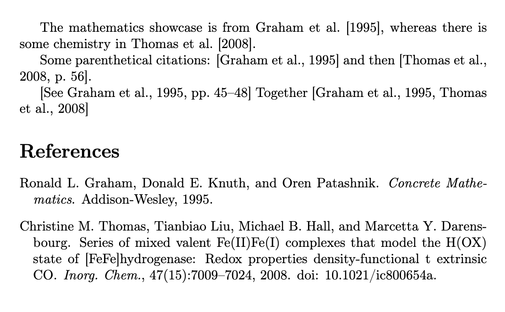
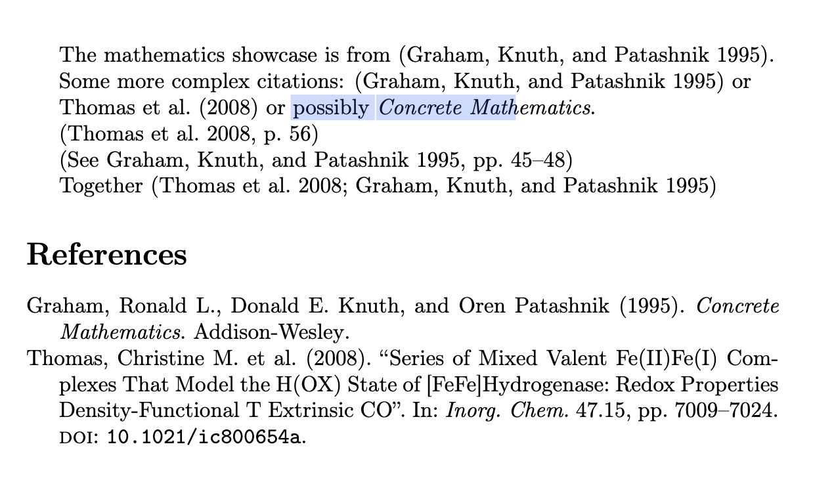
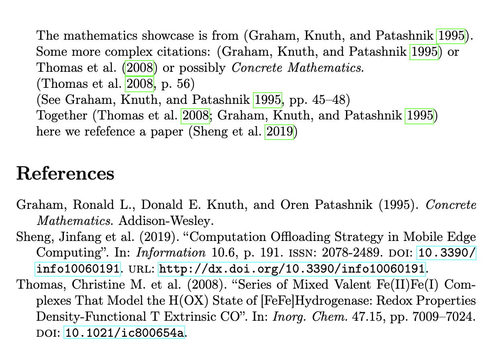
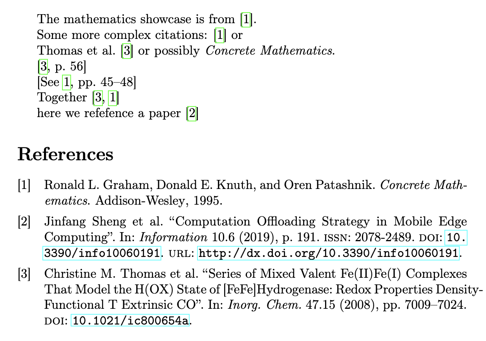
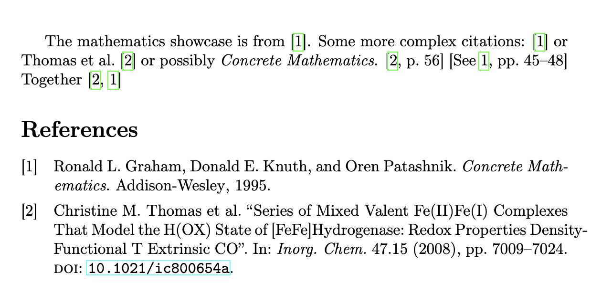

---
## Author
author:
  name: Филибер Никола
  degrees: Магистратура
  orcid: 0000-0000-000-000
  email: 1132259430@rudn.ru
  affiliation:
    - name: Российский университет дружбы народов
      country: Российская Федерация
      postal-code: 117198
      city: Москва
      address: ул. Миклухо-Маклая, д. 6

## Title
title: "Отчёт по лабораторной работе №6"
subtitle: "Computer Skills for Scientific Writing"
abstract: | 
  Лабораторная работа посвящена изучению методов работы с библиографией в LaTeX. Рассматриваются создание и использование библиографических баз данных, оформление цитат и списков литературы с помощью BibTeX и BibLaTeX
keywords: [LaTex, сitation, BibTeX, BibLaTeX  библиография, список литературы]
---

# Введение

## Актуальность

Корректное оформление библиографических ссылок и списка литературы является важной составляющей научных и академических работ. Использование BibTeX и BibLaTeX позволяет автоматизировать процесс цитирования, обеспечить единообразие оформления источников и повторно использовать библиографические данные. Изучение этих инструментов способствует повышению качества научных документов и упрощает работу с литературными источниками.

## Цель работы

Изучить способы работы с библиографией в LaTeX и освоить оформление цитат и списков литературы с помощью BibTeX и BibLaTeX.


## Задачи
- Изучить структуру и создание библиографических баз данных.

- Освоить оформление цитат и списков литературы с использованием подходов BibTeX и BibLaTeX.

- Изучить различные стили цитирования и сравнить возможности двух подходов.

## Объект и предмет исследования

Объект исследования: оформление библиографии в LaTeX.

Предмет исследования: методы и инструменты создания библиографических баз данных, оформления цитат и списков литературы с помощью BibTeX и BibLaTeX.

## Методы исследования

В работе используются методы изучения теоретического материала, анализа примеров кода LaTeX и практического экспериментирования. Проводится сравнение различных способов оформления библиографии

## Схема выполнения работы

На рис. -@fig-flowchart представлена общая последовательность действий при выполнении работы.


::: {#fig-flowchart}

```{mermaid}
%%| fig-width: 100%
graph TD
    A@{ shape: circle, label: "Начало" } --> B[ Изученить теоретический материал ]
    B --> C[ Создавать библиографические базы данных ]
    C --> D[ Работать с BibTeX и natbib]
    D --> E[ Работать с BibLaTeX и Biber ] 
    E --> F[ Сравнить стили цитирования ]
    F --> G[ Анализировать результатов ]
    G --> H[ Добавлять примеры и результаты в отчёт ]
    H --> I[ Размещать в Git-репозитории ]
    I --> J[ Создавать релиза ]
    J --> K@{ shape: dbl-circ, label: "Конец" }
```

Блок-схема выполнения лабораторной работы

:::

# Теоретическая часть

В табл. -@tbl-latex-bib приведено краткое описание основных пакетов и команд LaTeX для работы с библиографей.

| Элемент               | Назначение        | Описание                              |
|-----------------------|-------------------|---------------------------------------|
| `.bib`                | Формат файла      | Хранение библиографических записей    |
| `.bst`                | Файл стиля        | Определение стиля библиографии BibTeX |
| `BibTeX`              | Программа         | Обработка библиографических данных    |
| `Biber`               | Программа         | Обработка библ. с поддержкой Unicod   |
| `natbib`              | Пакет             | Управление цитированием в BibTeX      |
| `biblatex`            | Пакет             | Управление цитатами и библиографией   |
| `hyperref`            | Пакет             | Создание гиперссылок                  |
| `@article`            | Тип записи        | Описание научной статьи               |
| `@book`               | Тип записи        | Описание книги                        |
| `\citet`              | Команда           | Текстовое цитирование                 |
| `\citep`              | Команда           | Цитирование в скобках                 |
| `\bibliographystyle`  | Команда           | Выбор стиля библиографии BibTeX       |
| `\bibliography`       | Команда           | Подключение базы и вывод библиографии |
| `\addbibresource`     | Команда           | Подключение библиографической базы    |
| `\autocite`           | Команда           | Автоматический выбор формы цитирования|
| `\textcite`           | Команда           | Текстовое цитирование                 |
| `\parencite`          | Команда           | Цитирование в скобках                 |
| `\citetitle`          | Команда           | Цитирование названия источника        |
| `numbers`             | Опция `natbib`    | Числовое цитирование                  |
| `style=numeric`       | Опция `biblatex`  | Числовой стиль цитирования            |
| `style=authoryear`    | Опция `biblatex`  | Цитирование в формате «автор — год»   |

: описание основных пакетов и команд LaTeX для работы с таблицами {#-@tbl-latex-bib}

Более подробно LaTeX в [@latex_doc; @practical_scientific_writing].


# Материалы и методы

Материалы и программное обеспечение: компьютер(Macbook), система LaTeX[@latex_doc], текстовый редактор[@vscode], учебные материалы[@practical_scientific_writing] по оформлению библиогрфии, doi2bib[@doi2bib], git[@git_doc], github[@github_doc].

Методы: анализ примеров, сравнение способов форматирования и визуальная оценка полученных библиографии.


# Выполнение лабораторной работы

## Создание библиографической базы данных в формате .bib.

```bash
  touch learnlatex.bib
```

### Оформиеление BibTeX для статии
```bib
@article{Thomas2008,
    author = {Thomas, Christine M. and Liu, Tianbiao 
    and Hall, Michael B. and Darensbourg, Marcetta Y.},
    
    title = {Series of Mixed Valent {Fe(II)Fe(I)} 
    Complexes That Model the {H(OX)} State of [{FeFe}]
    Hydrogenase: Redox Properties Density-Functional T 
    Extrinsic {CO}},
    journal = {Inorg. Chem.},
    year = {2008},
    volume = {47},
    number = {15},
    pages = {7009-7024},
    doi = {10.1021/ic800654a},
}
```

### Оформиеление BibTeX для книг
```bib
@book{Graham1995,
    author = {Ronald L. Graham and Donald E. Knuth and Oren Patashnik},
    title = {Concrete Mathematics},
    publisher = {Addison-Wesley},
    year = {1995},
}
```

## Оформление цитат с использованием BibTeX и пакета natbib

```latex
\documentclass{article}
\usepackage[T1]{fontenc}
\usepackage{natbib}
\begin{document}
The mathematics showcase is from \citet{Graham1995}, 
whereas there is some chemistry in \citet{Thomas2008}.
Some parenthetical citations: \citep{Graham1995}
and then \citep[p.~56]{Thomas2008}.
\citep[See][pp.~45--48]{Graham1995}
Together \citep{Graham1995,Thomas2008}
\bibliographystyle{plainnat}
\bibliography{learnlatex}
\end{document}
```

{#fig-004 width=70%}

## Оформление цитат с использованием BibLaTeX.

```latex
\documentclass{article}
\usepackage[T1]{fontenc}
\usepackage[style=authoryear]{biblatex}
\addbibresource{learnlatex.bib} 
\begin{document}
Some more complex citations: \parencite{Graham1995} or
\textcite{Thomas2008} or possibly \citetitle{Graham1995}.
\autocite[56]{Thomas2008}
\autocite[See][45-48]{Graham1995}
Together \autocite{Thomas2008,Graham1995}
\printbibliography
\end{document}
```

{#fig-004 width=70%}

## Гиперссылки (Hyperlinks)
Использование пакета hyperref для автоматического создания гиперссылок в библиографии, в частности для URL и DOI.

```latex
\usepackage{hyperref}
```

{#fig-004 width=70%}

## Числовой стиль цитирования (Numeric style)
При данном стиле ссылки на источники отображаются в виде чисел в квадратных скобках вместо формата «автор — год».

### BibTeX (natbib)

```latex
\documentclass{article}
\usepackage[T1]{fontenc}
\usepackage[numbers]{natbib}
\usepackage{hyperref}

\begin{document}

The mathematics showcase is from \citet{Graham1995}.

Some more complex citations: \citet{Graham1995} or

\citet{Thomas2008} or possibly \citet{Graham1995}.

\citet[56]{Thomas2008}

\citet[See][45-48]{Graham1995}

Together \citet{Thomas2008,Graham1995}

here we refefence a paper \citet{Sheng2019}

\bibliographystyle{unsrtnat}
\bibliography{learnlatex}
\end{document}
```

{#fig-004 width=70%}


### BibLaTeX
Для применения числового стиля укажем опцию style=numeric

```latex
\documentclass{article}
\usepackage[T1]{fontenc}
\usepackage[style=numeric]{biblatex}
\usepackage{hyperref}
\addbibresource{learnlatex.bib}
\begin{document}
The mathematics showcase is from \autocite{Graham1995}.
Some more complex citations: \parencite{Graham1995} or
\textcite{Thomas2008} or possibly \citetitle{Graham1995}.
\autocite[56]{Thomas2008}
\autocite[See][45-48]{Graham1995}
Together \autocite{Thomas2008,Graham1995}
\printbibliography
\end{document}

```
{#fig-004 width=70%}


# Результаты

В ходе лабораторной работы были изучены принципы создания библиографических баз данных и освоены два подхода к оформлению библиографии: BibTeX и BibLaTeX. Рассмотрены различные команды и стили цитирования, способы добавления гиперссылок и особенности сортировки библиографических записей.

# Обсуждение результатов

Сравнение двух подходов показало, что BibTeX подходит для стандартного оформления библиографии, а BibLaTeX обеспечивает более гибкую настройку стилей цитирования и при использовании Biber поддерживает многоязычную сортировку источников. Выбор подхода зависит от требований к оформлению документа.

# Заключение

В ходе лабораторной работы были освоены основные методы работы с библиографией в LaTeX, изучены подходы BibTeX и BibLaTeX, а также различные способы оформления цитат и списков литературы. Полученные знания могут быть применены при подготовке научных и академических работ.

# Список литературы {.unnumbered}

::: {#refs}
:::

